# Design

This document describes the architecture of hopfilter: its modules, their interfaces, who owns what, and the rules that keep the dependency graph acyclic. It is written **before** each module is implemented and updated in the same pull request whenever an interface changes.

!!! info "Status legend"
    Each section is tagged **Implemented** or **Planned (Phase N)**. Signatures in planned sections are the intended contract; small changes during implementation are expected and recorded in the [decision log](#12-decision-log).

---

## 1. Goals and non-goals

**Goals**

- A correct HNSW index written from the paper, readable enough to learn from.
- Filtered search that keeps recall high when the filter is strict, without falling back to a full scan unless that is actually cheaper.
- A two-tower training pipeline whose output feeds the index directly.
- Every component is replaceable behind a small interface, so baselines (FAISS, hnswlib) and our own strategies run through the same benchmark harness.

**Non-goals for v0.1**

- Quantization (IVF-PQ, scalar quantization), GPU, distributed sharding, online deletes.

---

## 2. System overview

**Implemented:** build skeleton (Phase 0); data, model, training and exact evaluation (Phase 1); C++ HNSW core, serialization and Python bindings (Phase 2); SIMD kernels and parallel build (Phase 3); attribute filters and filtered search strategies (Phase 4). **Planned:** pipeline.

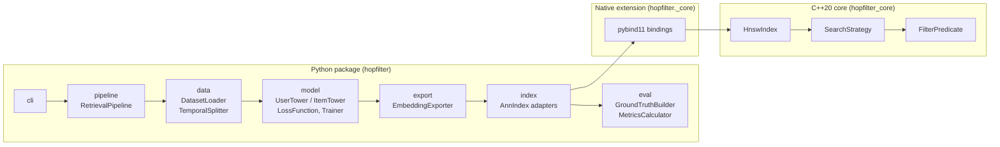

The end-to-end flow:

1. **Load and split** interactions by time, so no future interaction leaks into training.
2. **Train** the two towers with in-batch negatives and logQ correction.
3. **Export** item embeddings and item attributes; user embeddings are produced at query time.
4. **Build** the HNSW index over item embeddings and register item attributes.
5. **Search** with a user vector, `k`, and an optional filter expression.
6. **Evaluate** against exact brute-force ground truth computed with the same filter.

---

## 3. Layering and dependency rules

### 3.1 Layers

| Layer | May depend on | Must not depend on |
|---|---|---|
| `python/hopfilter/pipeline`, `cli` | every Python module | nothing above it |
| `python/hopfilter/{data,model,export,index,eval}` | `errors`, `_core`, third-party | `pipeline`, `cli`, each other except as listed in section 10 |
| `bindings/` | `hopfilter_core`, pybind11 | Python code |
| `core/` | the C++ standard library, OpenMP | Python, pybind11 |

### 3.2 C++ module graph

Arrows point from a module to what it depends on. The graph is acyclic, and each module becomes its own CMake target in Phase 2 so that every dependency is an explicit `target_link_libraries` line visible in review.

```mermaid
flowchart TD
    io --> index
    index --> search
    index --> graph
    index --> filter
    search --> graph
    search --> filter
    search --> distance
    graph --> distance
    graph --> storage
    distance --> common
    storage --> common
    filter --> common
    graph --> common
```

| Module | Header directory | Phase |
|---|---|---|
| `common` | `hopfilter/common/` | 0 (version), 2 (types, errors, VisitedSet) |
| `distance` | `hopfilter/distance/` | 2 (scalar), 3 (SIMD) |
| `storage` | `hopfilter/storage/` | 2 |
| `graph` | `hopfilter/graph/` | 2 |
| `filter` | `hopfilter/filter/` | 4 |
| `search` | `hopfilter/search/` | 2 (unfiltered), 4 (filtered) |
| `index` | `hopfilter/index/` | 2 |
| `io` | `hopfilter/io/` | 2 |

---

## 4. Common vocabulary

**Implemented** (Phase 2).

```cpp
namespace hopfilter {

using NodeId = std::uint32_t;
using LevelIndex = std::uint8_t;
using Dimension = std::size_t;

struct Neighbor {
    NodeId id;
    float distance;
};

using SearchResults = std::vector<Neighbor>;

class InvalidArgumentError : public std::invalid_argument { using std::invalid_argument::invalid_argument; };
class IndexStateError : public std::logic_error { using std::logic_error::logic_error; };
class SerializationError : public std::runtime_error { using std::runtime_error::runtime_error; };

}  // namespace hopfilter
```

- `NodeId` is 32-bit. An index holds at most 2^32 - 1 items, which halves the memory of neighbor lists compared to 64-bit ids.
- `SearchResults` is always sorted by ascending distance and never contains duplicate ids. Property tests enforce both.
- Vectors cross every interface as `std::span<const float>`, so callers never hand over ownership by accident.

---

## 5. C++ core modules

### 5.1 distance (Implemented scalar, Phase 3 SIMD)

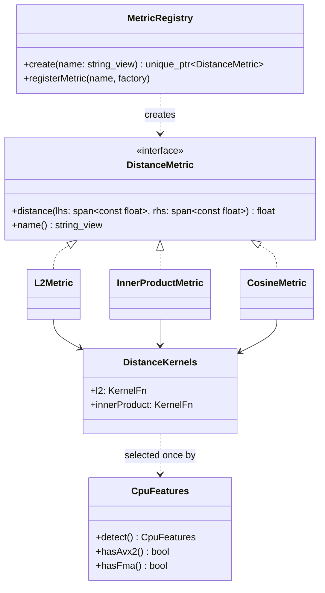

- **Strategy.** Every metric returns a value where *smaller is closer*. Inner product returns `-dot(a, b)`, so search code never branches on the metric.
- **Cosine** expects normalized vectors. `CosineMetric` normalizes on insert and query and then reuses the inner-product kernel. That is cheaper than normalizing inside every distance call.
- **Runtime dispatch** (Phase 3). `DistanceKernels` is a pair of function pointers for one `KernelSet` (`Scalar` or `Avx2`). At startup the best set the CPU supports is chosen: `__builtin_cpu_supports` on GCC/Clang, `cpuid` plus `xgetbv` on MSVC, so the OS must also save the AVX registers. The AVX2/FMA kernels live in their own translation unit, the only one compiled with `-mavx2 -mfma` or `/arch:AVX2`, and only on x86-64. A wheel therefore runs on any CPU and uses AVX2 only where it exists. `useKernelSet` switches the active set at runtime (an atomic pointer), so benchmarks compare scalar and AVX2 in one binary; it throws `InvalidArgumentError` for an unsupported set.
- **Open/closed.** New metrics register with `MetricRegistry` under a config name, without touching existing classes.
- Virtual dispatch costs one indirect call per distance evaluation. Phase 3 measures it; if it shows up in profiles, the search loop is templated on the metric type, with the virtual interface kept for configuration.

### 5.2 storage (Implemented)

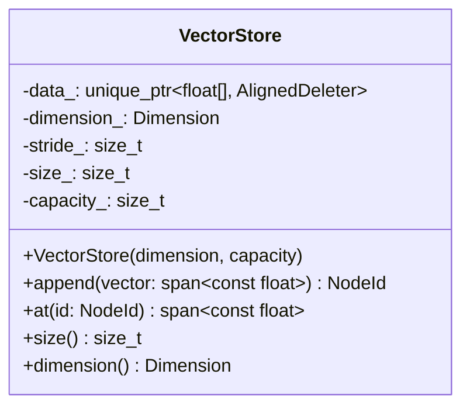

- One contiguous allocation, 64-byte aligned. Each row is padded up to a multiple of the widest SIMD register, so kernels can use aligned loads with no tail handling.
- `capacity` is fixed at construction. Growing would invalidate spans handed out to concurrent readers, so `append` past capacity throws `IndexStateError`.

### 5.3 graph (Implemented)

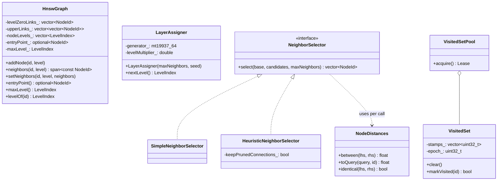

- **Level-0 layout.** Level 0 holds most edges and is read on every query, so its links live in one flat array of `(2 * M) + 1` slots per node: a count followed by up to `2 * M` ids. Upper levels hold few nodes and use per-node vectors.
- **LayerAssigner** draws `floor(-ln(U(0,1)) * mL)` with `mL = 1 / ln(M)`, as in the paper. A seed makes builds reproducible.
- **HeuristicNeighborSelector** follows Algorithm 4 of Malkov and Yashunin: a candidate is kept only if it is at least as close to the base as to every neighbor already selected. That keeps edges spread in different directions. `keepPrunedConnections` refills free slots with the closest discarded candidates. The paper's `extendCandidates` flag is not implemented: it targets extremely clustered data and would need graph access during selection.
- **Exact duplicates.** With identical vectors every comparison is a tie. An exact copy of an already selected neighbor (detected by comparing vectors, not by distance 0, since `1 - dot` is not a metric) takes that neighbor's slot, newest copy winning, instead of using a new slot. Without this rule a duplicate cluster fills every slot with copies and traps any search that enters it. Known limit: when one vector is inserted more times than `efConstruction`, the insert-time search cannot tell the copies apart, and some copies may be unreachable. Searches still return correct distances, because any copy is an equally good answer. Deduplicate before inserting if every copy must be retrievable.
- **NodeDistances** is a view over the metric and vector store passed to selectors on each call. Selectors therefore hold no references to index storage, which the builder could not give them before the index exists.
- **VisitedSet** keeps one stamp per node and bumps an epoch counter in `clear()`, so clearing is O(1) rather than O(N). On counter wrap-around the stamps are wiped once. `VisitedSetPool` hands sets out through RAII leases, so concurrent queries never share one and a 1M-node set is never reallocated per query.

### 5.4 index (Implemented)

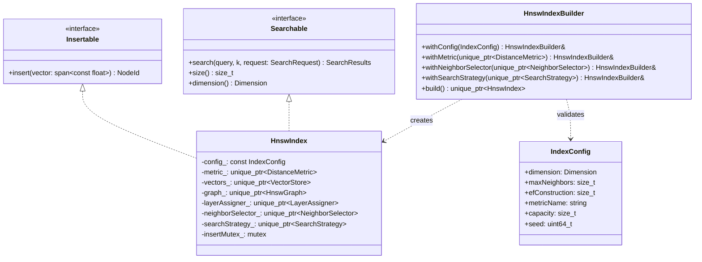

- **Builder.** `HnswIndexBuilder::build()` is the only way to create an `HnswIndex`. It validates the config (positive dimension, `maxNeighbors >= 2`, `efConstruction >= maxNeighbors`, a known metric name) and throws `InvalidArgumentError` with a message naming the field. Anything the caller does not inject gets a default, such as `HeuristicNeighborSelector` or the registry metric for `metricName`.
- **Dependency inversion.** `HnswIndex` never constructs its collaborators. It receives them from the builder, which is how tests inject a fake `LayerAssigner` to build a graph with known levels.
- **Attributes.** The index owns an `AttributeStore`. `setCategoricalAttribute` and `setNumericAttribute` reject a column longer than `capacity`; `attributes()` gives read-only access for compiling filters.
- **Interface segregation.** Benchmark adapters for FAISS and hnswlib implement only `Searchable`. Read-only consumers take a `const Searchable&`. There is no `Serializable` interface on the index: `io` depends on `index`, so the index implementing serialization would create a cycle. `IndexSerializer` is the single entry point.

### 5.5 filter (Phase 4)

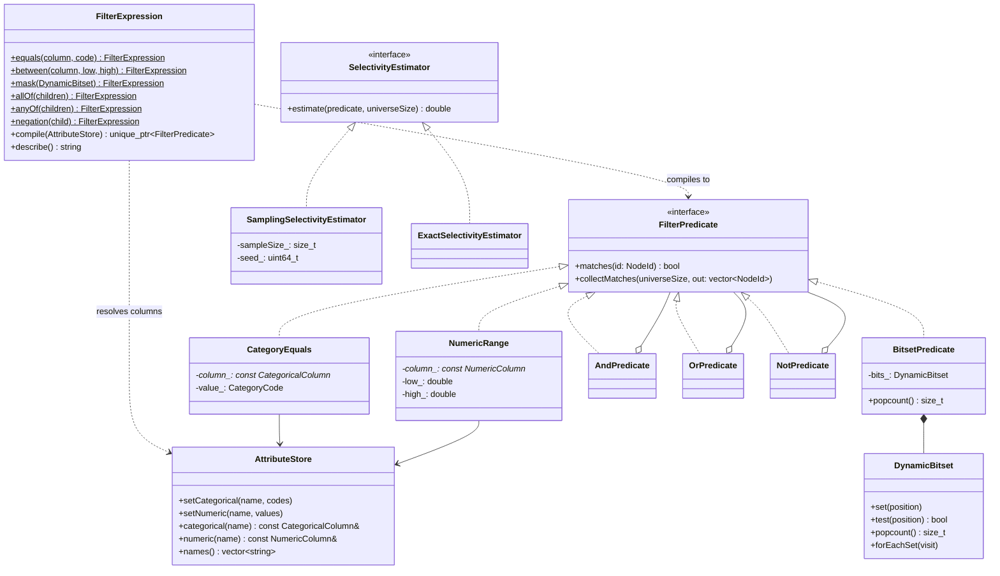

- **Columns.** Attributes are stored column-wise: a `CategoricalColumn` is a `std::vector<CategoryCode>` (32-bit codes) and a `NumericColumn` is a `std::vector<double>`. A predicate check is one array read, and a column is cheap to scan when building a bitset. Setting a column under an existing name replaces it, whatever its kind. A row past the end of a column matches no predicate on that column, so vectors added after the attributes were set are excluded until their attributes are set too.
- **Predicates** form a composite: `AndPredicate`, `OrPredicate` and `NotPredicate` own their children. `NumericRange` is closed on both ends. `collectMatches` appends every matching id below `universeSize`; the default walks all ids, and `BitsetPredicate` overrides it with a word-at-a-time scan.
- **Expressions.** `FilterExpression` is an immutable value tree that does not know about any store. Python builds one with `Filter.equals(...) & Filter.between(...)`, and the bindings compile it into a predicate tree **once per `search` call**, not once per query. Compiling throws `InvalidArgumentError` for an unknown column, a column of the wrong kind, or `low > high`.
- **Lifetime.** A compiled predicate points into the `AttributeStore` it was compiled against and must not outlive it, or survive a change to the columns it reads.
- **Selectivity.** `ExactSelectivityEstimator` evaluates the predicate on every id: exact, O(N). `SamplingSelectivityEstimator` evaluates it on a fixed-seed random sample (1,024 ids by default), which costs a few microseconds and is accurate enough to choose a strategy. Both return the matching fraction in `[0, 1]`.

### 5.6 search (Phase 2 unfiltered, Phase 4 filtered)

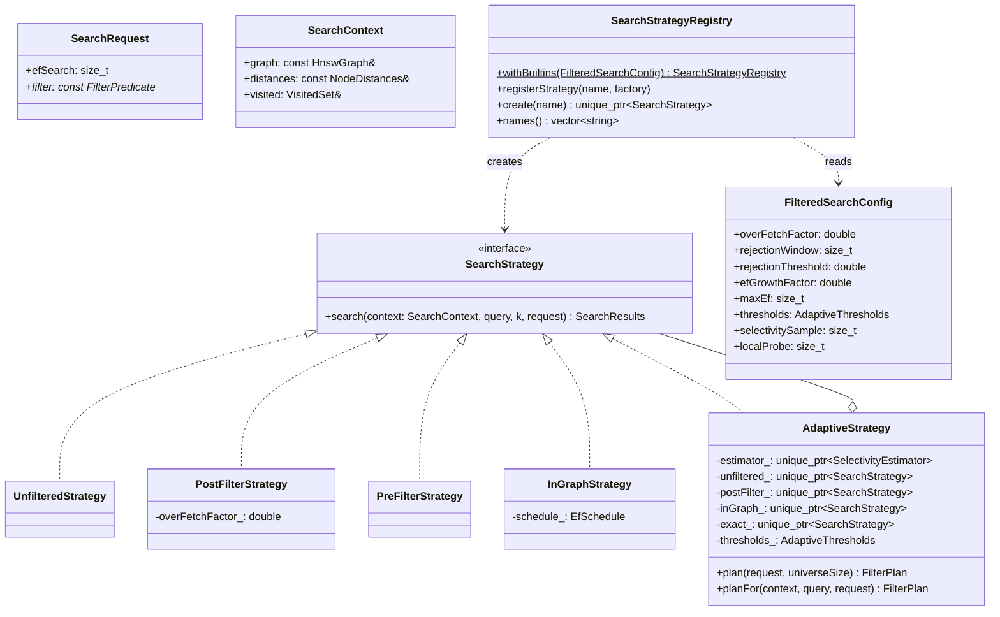

| Registry name | Strategy | How it handles a filter | Strength | Weakness |
|---|---|---|---|---|
| `unfiltered` | `UnfilteredStrategy` | Rejects a request that carries one | Fastest path | n/a |
| `post_filter` | `PostFilterStrategy` | Searches with `ef = max(efSearch, k * overFetchFactor)`, then drops non-matching results | Free when most items match | Returns fewer than `k` results under strict filters |
| `pre_filter` | `PreFilterStrategy` | Collects the matching ids and ranks them by brute force | Exact; cheap when very few items match | O(N) predicate checks plus O(matching * d) distances per query |
| `in_graph` | `InGraphStrategy` | Traverses the full graph; every node can route, only matching nodes enter the result heap; can widen `ef` while the rejection rate is high (off by default) | Keeps graph connectivity under medium selectivity | Visits more nodes than unfiltered search; degrades toward a scan as matches get rare |
| `adaptive` | `AdaptiveStrategy` | Samples selectivity, then delegates | Picks the cheapest correct option | Estimation cost per query; thresholds need tuning |

- `HnswIndex` uses `adaptive` unless the builder injects another strategy. A request without a filter goes straight to the unfiltered path, so unfiltered searches pay nothing for filter support.
- `AdaptiveStrategy::plan` returns the `FilterPlan` it would use from global selectivity alone (`Unfiltered`, `PostFilter`, `InGraph` or `Exact`). The rule: selectivity at or above `postFilterAbove` uses the post-filter, below `exactBelow` uses exact search, and anything in between uses in-graph search. The defaults (`postFilterAbove = 0.9`, `exactBelow = 0.015`) come from the Phase 4 sweep.
- **Query-local check.** Global selectivity cannot see whether the matching items sit near the query or in some distant region. In the second case in-graph search has to cross much of the graph before it finds `ef` matches, and exact search is cheaper. So when the global plan is `InGraph`, `planFor` also descends to level 0 and probes the query's neighbourhood: a breadth-first walk over level-0 links from the descent's end point, checking the filter on up to `localProbe` nodes (1,024 by default) with no distance computations. If the matching share there is below `distantShare` times the global selectivity (0.25), and the global selectivity is below `distantExactBelow` (0.25), the query goes to exact search. Above that selectivity the exact scan is too expensive to win even for distant matches. `distantShare = 0` turns the check off.
- Every threshold lives in `FilteredSearchConfig`. The probe is `neighbourhoodShare` in `search/neighbourhood_probe.hpp`; it reuses the query's leased `VisitedSet`, so it allocates nothing.
- `HnswIndex::search` has an overload that takes a `const SearchStrategy&`, which is how the benchmarks and the Python `strategy=` argument run one index under every strategy.
- `SearchContext` gives a strategy read-only access to the index internals plus a per-thread `VisitedSet`. Strategies therefore stay stateless, and one strategy instance serves all threads.

### 5.7 io (Implemented)

`IndexSerializer` writes a versioned, little-endian binary format:

| Section | Contents |
|---|---|
| Header | Magic `HOPF`, format version (uint32), endianness marker, `IndexConfig` fields |
| Vectors | Row count and stride, then raw aligned rows |
| Graph | Node levels, entry point, max level, level-0 link block, upper-level links |
| Attributes | Format version 2: categorical columns, then numeric columns; each is a name, a row count and the raw values |
| Footer | CRC-32 of every preceding byte |

- Loading checks magic and version, validates every header field before allocating storage, bounds-checks each count and id, and verifies the CRC before returning an index. Any problem, including an allocation failure caused by a corrupt header, surfaces as `SerializationError`.
- **Compatibility rule:** version N reads files from versions N and N-1. A fixture index saved by the previous release is checked into `tests/fixtures/` and loaded in CI.

---

## 6. Key algorithms

All follow Malkov and Yashunin (arXiv:1603.09320). Only the shape is described here; the implementation is written from the paper.

**Insert(q)**

1. Draw level `l` from `LayerAssigner`.
2. From the entry point, greedily descend through levels `maxLevel ... l+1` with `ef = 1`.
3. For each level `min(l, maxLevel) ... 0`: run `searchLayer(q, entry, efConstruction)`, choose neighbors with `NeighborSelector` (`M` on upper levels, `2M` on level 0), connect both directions, and shrink any neighbor list that overflows by re-running the selector on it.
4. If `l > maxLevel`, `q` becomes the new entry point.

**searchLayer(q, entries, ef)** is a best-first search with a min-heap of candidates and a bounded max-heap of results. It stops when the closest unexplored candidate is farther than the farthest kept result.

**Filtered searchLayer** (`InGraphStrategy`) adds two rules. A node always enters the candidate heap, so it can still be used to route. A node enters the result heap only if `filter.matches(id)`. Optionally, after every `rejectionWindow` visited nodes, if the share of rejected nodes is above `rejectionThreshold`, `ef` grows by `efGrowthFactor` up to `maxEf`. A growth factor of 1 turns this off, and that is the default: on SIFT1M it made every query run at `maxEf` (see the [decision log](#12-decision-log)).

The search stops when the closest unexplored candidate is farther than the `ef`-th closest *matching* node found so far. That node sits at roughly rank `ef / selectivity` among all nodes, so the work grows as `ef / selectivity`: cheap at 10%, close to a full scan at 0.1%. This is the cost model `AdaptiveStrategy` encodes, and why it switches to exact search when fewer than `ef` items are expected to match.

---

## 7. Concurrency contract

| Operation | Guarantee |
|---|---|
| `search` on a built index | Safe from any number of threads. Each query leases its own `VisitedSet` from a pool; only the lease and return take a short lock, the traversal itself takes none |
| `insert` / `insertBatch` | Ids, vectors and levels are assigned sequentially under a short allocation lock, so row *i* of a batch always gets id *i*. Linking then runs on `threads` workers. Neighbor lists are read and written under striped per-node locks (a copy is taken under the lock, never a reference). The entry point is read under a shared lock and replaced under an exclusive one, taken only by a node that lands above the current top level. A node's own neighbor list is merged with any back-links concurrent inserts already added, never overwritten: another thread can descend into a node through an upper layer before that node has written its level-0 list. Levels are deterministic for a given seed and order; with more than one thread the edges are not. Shrinking a full list may occasionally drop a node's last incoming edge; tests allow at most 0.1% of nodes unreachable after a parallel build (measured: 0-1 of 4,000 at 8 threads) |
| Batch search | `parallelFor` splits queries across threads; each query leases its own `VisitedSet` and reads the graph without locks |
| `search` concurrent with `insert` | Not supported in v0.1. Documented, and asserted in debug builds |
| `save` | Safe concurrently with `search`; not with `insert` |
| Filtered `search` | Same as `search`. The compiled predicate is read-only and shared by every query of a batch |
| Setting attributes | Not concurrent with `search` or `save`: replacing a column frees the storage a compiled predicate points into |
| Python | The GIL is released inside `search` and batch `insert`, so Python threads scale |

The TSan CI job runs a concurrent-search stress test, and from Phase 3 a parallel-build test.

---

## 8. Ownership and memory

- `HnswIndex` owns everything it uses through `std::unique_ptr` members and plain containers. There are no shared pointers inside the index and no raw owning pointers anywhere.
- `FilterExpression` is the one shared-ownership type: its nodes are immutable and held by `std::shared_ptr<const Node>`, so combining two expressions in Python copies two pointers instead of two trees.
- Strategies, selectors and predicates hold `const&` to data they do not own. Their lifetime is bounded by the call or by the owning index.
- Memory per item is roughly `4 * stride + 4 * (2M + 1) + small upper-level overhead`. Phase 3 reports measured peak memory next to this estimate.

---

## 9. Error handling

| Where | Mechanism |
|---|---|
| C++ API boundary (builder, insert, search arguments, load) | Throw `InvalidArgumentError`, `IndexStateError` or `SerializationError` with a message naming the bad field |
| C++ hot loops (distance, searchLayer) | No exceptions and no allocation; inputs are validated before the loop |
| Bindings | Each C++ error type is registered with pybind11 and surfaces as the matching Python error below |
| Python | `InvalidConfigError(HopfilterError, ValueError)`, `IndexNotBuiltError(HopfilterError, RuntimeError)`, plus more added only when a caller needs to tell them apart |

The Python error types are **implemented** in `hopfilter.errors`.

---

## 10. Python package

### 10.1 Data, model and training (Implemented, Phase 1)

The training stack is an optional extra (`pip install hopfilter-ann[train]`) so that index-only users never install PyTorch. Nothing under `hopfilter.data`, `hopfilter.model` or `hopfilter.eval` is imported by `hopfilter/__init__.py`.

| Module | Contents |
|---|---|
| `hopfilter.config` | `load_config(path, config_type)`: YAML into a frozen dataclass, rejecting unknown or mistyped keys |
| `hopfilter.data.download` | `DatasetSpec`, `DATASETS` registry, `UrlFetcher` protocol, `DatasetDownloader` |
| `hopfilter.data.movielens` | `MovieLens1MLoader`, `MovieLens25MLoader` |
| `hopfilter.data.dataset` | `InteractionDataset`, column-name constants, `keep_positive` |
| `hopfilter.data.splits` | `SplitConfig`, `TemporalSplitter`, `DataSplits` |
| `hopfilter.data.encoding` | `IdEncoder`, `build_genre_matrix` |
| `hopfilter.model.towers` | `TowerConfig`, `UserTower`, `ItemTower`, `TwoTowerModel` |
| `hopfilter.model.losses` | `LossFunction` protocol, `InBatchSoftmaxLoss`, `LogQCorrectedLoss` |
| `hopfilter.model.frequency` | `ItemFrequencyEstimator` |
| `hopfilter.model.training` | `TrainerConfig`, `InteractionBatcher`, `Trainer`, `TrainingHistory` |
| `hopfilter.eval.retrieval` | `ExactRetriever`, `PopularitySegmenter`, `RetrievalEvaluator`, `RetrievalReport` |

#### Data

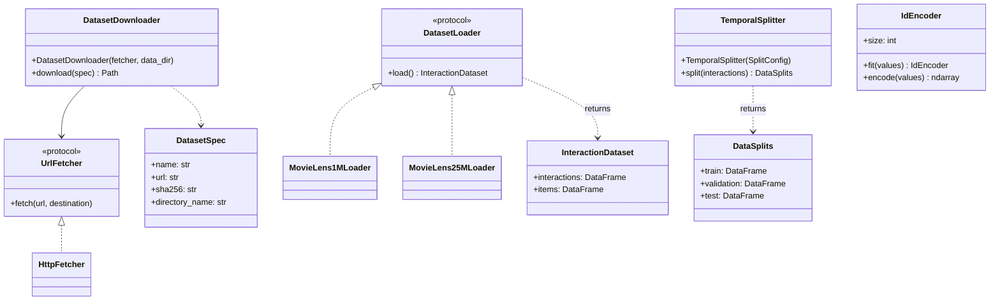

- **Schema.** `interactions` has `user_id`, `item_id`, `rating`, `timestamp` (seconds since the epoch). `items` has `item_id`, `title`, `year` and `genres` (a list of strings). Both loaders normalize to this schema, so nothing downstream knows which MovieLens release it is reading.
- **Download integrity.** Each `DatasetSpec` carries the SHA-256 of its archive. A mismatch raises `DatasetIntegrityError` and deletes the partial file. Extraction rejects archive members that would land outside the target directory. The fetcher is injected, so tests never touch the network.
- **Positives.** `keep_positive(interactions, min_rating)` keeps ratings at or above the threshold (4.0 by default). Retrieval is trained on "liked" interactions only.
- **Temporal split, no leakage.** `TemporalSplitter` sorts by timestamp and cuts at the global `1 - validation - test` and `1 - test` quantiles, so every training interaction happens strictly before every validation interaction, and every validation interaction strictly before every test one. Validation and test rows whose user or item never appears in training are dropped and counted, because ID-embedding towers cannot represent them.
- **Encoding.** `IdEncoder` is fitted on the training split only and maps raw ids to contiguous indices `0..n-1`. `build_genre_matrix` turns item genres into a multi-hot matrix aligned with those indices.

#### Model

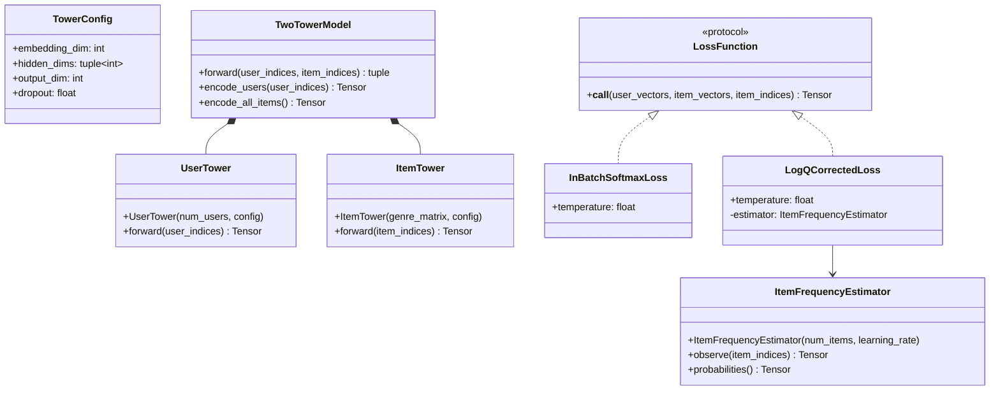

- **Towers.** `UserTower` is an ID embedding followed by an MLP. `ItemTower` concatenates an ID embedding with the mean of the item's genre embeddings, then applies an MLP. Genre features let rarely seen items share signal with popular items of the same genre. Both towers L2-normalize their output, so inner product equals cosine similarity and the index will use `InnerProductMetric`.
- **In-batch softmax.** For a batch of `B` (user, item) positives, the logits are `S = U Vᵀ / τ`. Row `i` is a `B`-way classification whose correct class is column `i`. Where the same item appears twice in a batch, the duplicate column is masked to `-inf` in the other row, so a positive is never treated as its own negative.
- **logQ correction** (Yi et al., RecSys 2019). In-batch negatives are sampled in proportion to item popularity, so popular items are pushed down far more often than uniform sampling would push them. The corrected logit is `s(i, j) - log q_j`, applied to every column (positive and negatives alike), where `q_j` is the probability that item `j` appears in a batch.
- **Streaming frequency estimate** (Yi et al., Algorithm 2). Per item, `ItemFrequencyEstimator` keeps the step at which it was last seen (`A`) and a moving average of the gap between sightings (`B`). On every training step `t`, for each item `j` in the batch: `B[j] ← (1 - α) B[j] + α (t - A[j])`, then `A[j] ← t`. The estimate is `q_j = 1 / B[j]`. Items are already encoded to contiguous indices, so the paper's hash function is the identity. `observe` updates the state and returns `log q` for the batch in one call, so the loss cannot use a stale estimate.
- **Hypothesis tested, not assumed.** The prediction was that removing the popularity penalty raises overall recall but shifts recommendations towards popular items, so tail recall could fall. The [MovieLens-1M ablation](benchmarks.md#logq-ablation-phase-1) confirmed both: logQ raised recall@50 from 0.039 to 0.109 while tail recall@50 fell from 0.049 to 0.033.

#### Training

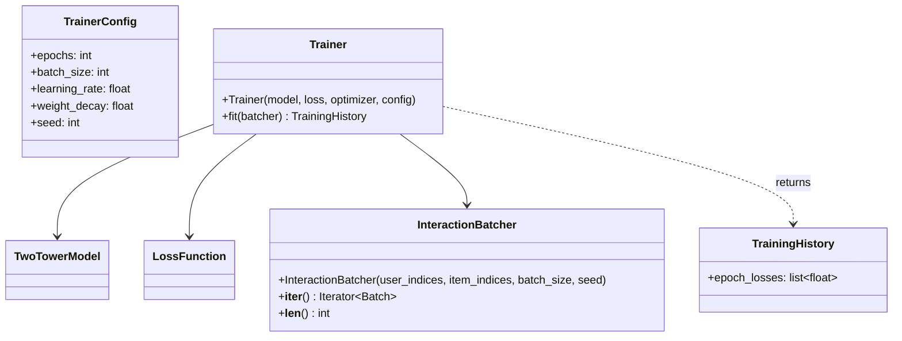

- The model, loss and optimizer are created by the caller and injected, so the ablation swaps only the loss.
- `InteractionBatcher` reshuffles every epoch from its own seeded generator and drops the final partial batch. That keeps the batch size, and with it the meaning of `q_j`, constant across steps.

#### Evaluation

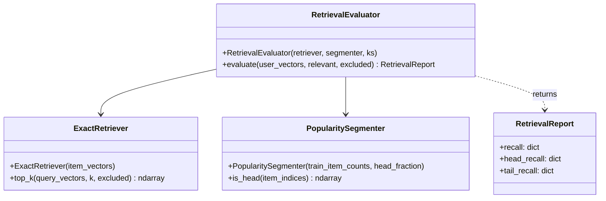

- **Exact search.** `ExactRetriever` scores every item by inner product in chunks of users and masks the items each user already interacted with in training. This is the ground truth that the HNSW index is later measured against.
- **Recall definition.** `recall@k` is the fraction of held-out positive interactions whose item appears in that user's top-k: the total number of hits divided by the total number of held-out positives. Head and tail recall use the same formula restricted to held-out interactions on head or tail items.
- **Head and tail.** `PopularitySegmenter` ranks items by training interaction count. The top `head_fraction` of items (20% by default) are the head and the rest are the tail.

### 10.2 Index, evaluation and pipeline (Planned, Phases 2 and 5)

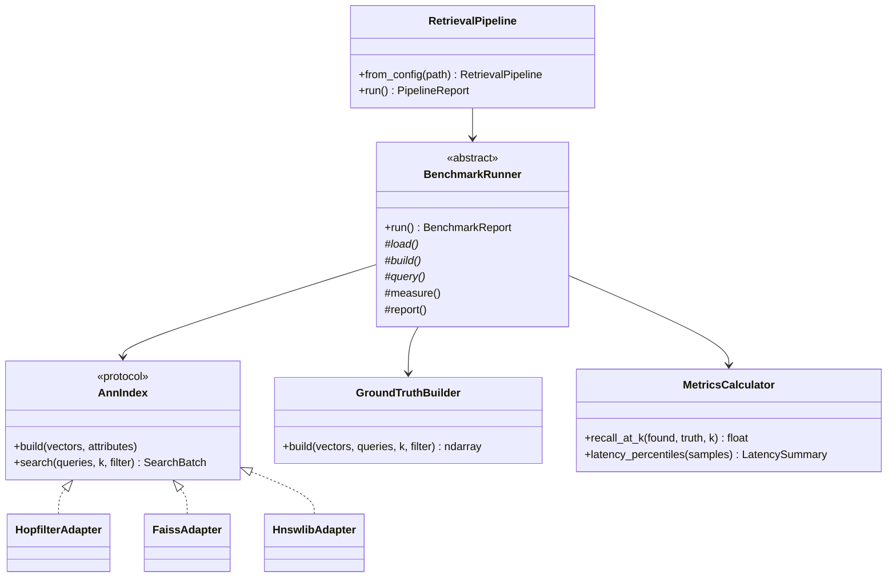

- **Adapter.** Every library is driven through `AnnIndex`, so timing code is shared and the comparison is fair by construction.
- **Template Method.** `BenchmarkRunner.run()` fixes the order (load, build, warm-up, query repeats, measure, report). Subclasses override only the dataset-specific steps.
- **Facade.** `RetrievalPipeline` is the only class the CLI talks to.
- Configs are frozen dataclasses parsed from YAML. An unknown key raises `InvalidConfigError` instead of being silently ignored.

---

## 11. Extension points

| To add | Implement | Register with | Touch existing classes? |
|---|---|---|---|
| A distance metric | `DistanceMetric` | `MetricRegistry` | No |
| A neighbor selection rule | `NeighborSelector` | `HnswIndexBuilder::withNeighborSelector` | No |
| A filtered search strategy | `SearchStrategy` | `SearchStrategyRegistry` | No |
| A predicate type | `FilterPredicate` | A new `FilterExpression` node kind | `FilterExpression` only |
| A dataset | `DatasetLoader` | Dataset registry | No |
| A loss | `LossFunction` | Loss registry | No |
| A baseline library | `AnnIndex` adapter | Benchmark config | No |

---

## 12. Decision log

| # | Date | Decision | Why |
|---|---|---|---|
| 1 | 2026-10-17 | C++20 instead of C++17 | `std::span` for non-owning vector views, concepts for kernel templates, `std::bit_width`/`popcount` for bitsets. Supported by every compiler in the CI matrix |
| 2 | 2026-10-17 | Python 3.13 minimum, 3.14 for development | Current interpreters only; fewer wheels to build and test |
| 3 | 2026-10-17 | uv with dependency groups and `uv.lock` | One command (`uv sync`) builds the extension and installs pinned tooling, and pre-commit and CI reuse the same lock |
| 4 | 2026-10-17 | pybind11 3 over nanobind | Mature NumPy buffer support and exception translation; revisit if binding overhead shows up in Phase 3 profiles |
| 5 | 2026-10-17 | Package version read from `CMakeLists.txt` | One source of truth for the C++ library and the Python distribution |
| 6 | 2026-10-17 | 32-bit `NodeId` | Halves neighbor-list memory; v0.1 targets at most tens of millions of items |
| 7 | 2026-10-17 | Smaller-is-closer for every metric | Search code never branches on metric type |
| 8 | 2026-10-17 | PyTorch, Polars and PyYAML in a `train` extra, not core dependencies | Index users should not download PyTorch. Torch-dependent tests are skipped when the extra is absent (wheel smoke tests, Docker `dev` image) |
| 9 | 2026-10-17 | PyTorch from the CPU wheel index on Linux | The default Linux wheels bundle CUDA (several GB). The CPU build is enough for MovieLens-scale training and keeps CI fast |
| 10 | 2026-10-17 | Global temporal split rather than leave-last-out per user | Leave-last-out lets training see interactions from other users that happen after a test interaction. A global cut leaks nothing |
| 11 | 2026-10-17 | Interaction-level (micro) recall | Head and tail segments are empty for many users, so per-user averages would be dominated by users with one or two segment items |
| 12 | 2026-10-18 | One CMake target per core module | Every module dependency is an explicit `target_link_libraries` line, so a new edge in the module graph shows up in review |
| 13 | 2026-10-18 | clang-tidy 22 (clang-format stays at 18) | clang-tidy 18 could parse neither the MSVC STL nor GCC 16's libstdc++, so it only ran in CI. 22 runs locally against an MSVC compile database |
| 14 | 2026-10-18 | Visited sets come from a mutex-guarded pool, not thread-locals | The lock covers only lease and return. Unlike a `thread_local`, the pool is per index, so two indexes of different sizes never share a set |
| 15 | 2026-10-18 | Heuristic keeps ties and collapses exact duplicates into one slot | Measured on 80 points including 30 copies: pruning ties left 9 nodes reachable, keeping all ties trapped searches inside the copies. Collapsing copies keeps every distinct node reachable |
| 16 | 2026-10-18 | Level generator built from raw `mt19937_64` bits | `std::uniform_real_distribution` differs between standard libraries; raw bits give the same graph for the same seed on MSVC, libstdc++ and libc++ |
| 17 | 2026-10-18 | No `Serializable` interface on `HnswIndex` | `io` depends on `index`; `IndexSerializer` owns the format so the index stays unaware of it |
| 18 | 2026-10-18 | Striped node locks (65,536 mutexes) instead of one mutex per node | A `std::mutex` is 80 bytes on MSVC, so one per node would cost 80 MB at 1M nodes; stripes cost 5 MB and two nodes rarely share a stripe |
| 19 | 2026-10-18 | Parallel build assigns ids before linking | Callers rely on row *i* becoming id *i*; assigning ids in whatever order threads finish would break that |
| 20 | 2026-10-18 | Comparison libraries live in a `compare` dependency group, outside `dev` | hnswlib only ships a source distribution and compiles on install; keeping it out of the default environment keeps `uv sync` and CI fast |
| 21 | 2026-10-19 | In-graph `ef` widening exists but is off by default | The rejection rate is just `1 - selectivity`, so below 10% selectivity the rule fired on every window and every query ran at `maxEf`: 158 QPS at recall 1.0 whatever `efSearch` was, against 10,976 QPS at 0.92 and 3,949 at 0.99 without it (SIFT1M, 16 threads) |
| 22 | 2026-10-19 | Adaptive search goes exact when fewer items are expected to match than `ef` | In-graph search stops only after `ef` matching nodes are found, so with fewer matches than that it walks the whole reachable graph; the exact scan is cheaper and returns recall 1 |
| 23 | 2026-10-19 | Adaptive thresholds 0.9 (post-filter) and 0.015 (exact) | At 50% selectivity post-filtering stayed below recall 0.90 on a clustered attribute while in-graph reached 0.98; at 1% exact search already beat in-graph. A wrong in-graph pick costs QPS, a wrong post-filter pick costs recall, so the post-filter cut-off is set high |
| 24 | 2026-10-19 | A filter is compiled once per `search` call, not per query | Every query in a batch shares the filter, so the predicate tree is built once and read concurrently; per-query compilation would allocate inside the parallel loop |
| 25 | 2026-10-19 | `Filter` raises on `bool()` | `a and b` on two filters would silently evaluate to `b`; raising makes the mistake loud and points to `&`, `\|` and `~` |
| 26 | 2026-10-19 | clang-tidy `misc-no-recursion` disabled | Filter expressions are trees and are compiled and described recursively; an explicit stack would be longer and harder to read for depths that stay in single digits |
| 27 | 2026-10-19 | A level-0 neighbourhood probe refines the in-graph decision per query | On the clustered SIFT1M attribute at 10%, adaptive search ran in-graph at 185 QPS where exact search ran at 356. Among each query's 100 true neighbours, the matching share was below a quarter of the global share for 60% of clustered queries but for under 1% of uniform ones, so the signal separates the two cases. The probe only checks the filter on graph neighbours, so it costs no distance computations |
