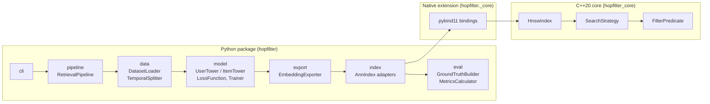
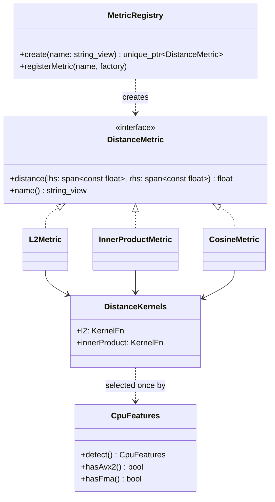
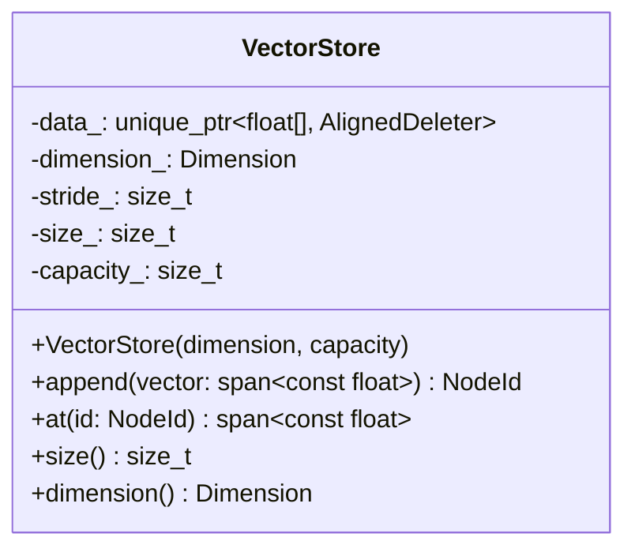
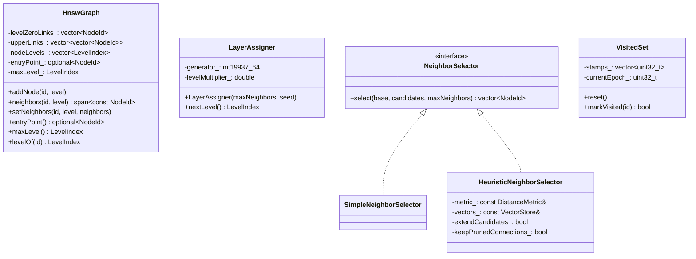
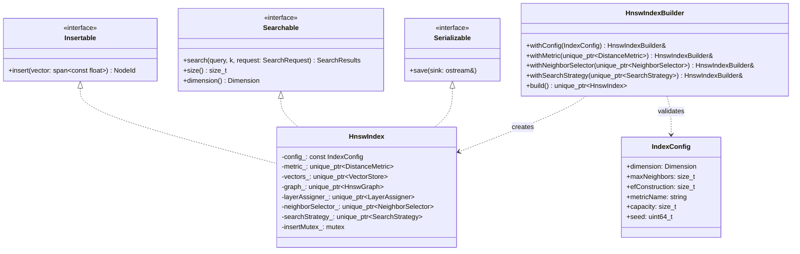
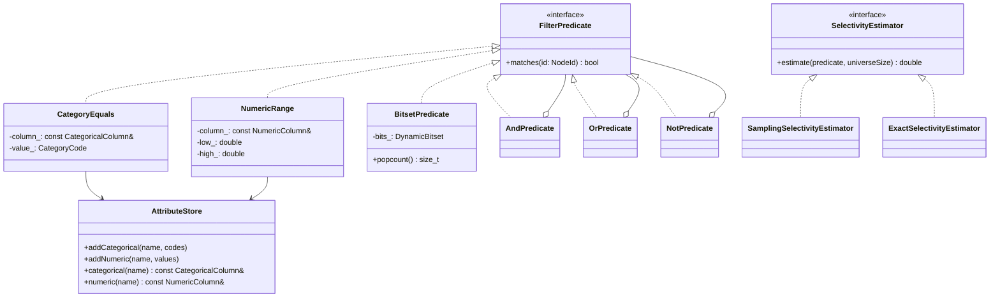
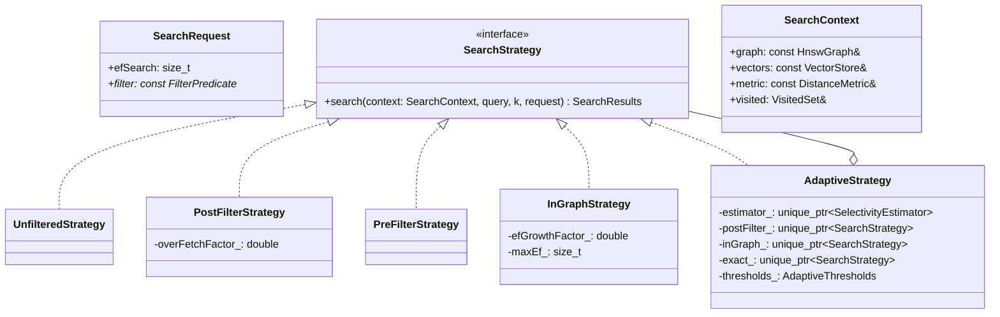
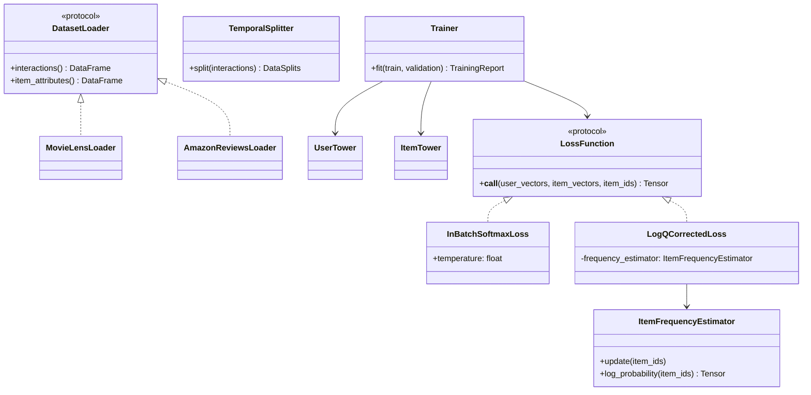
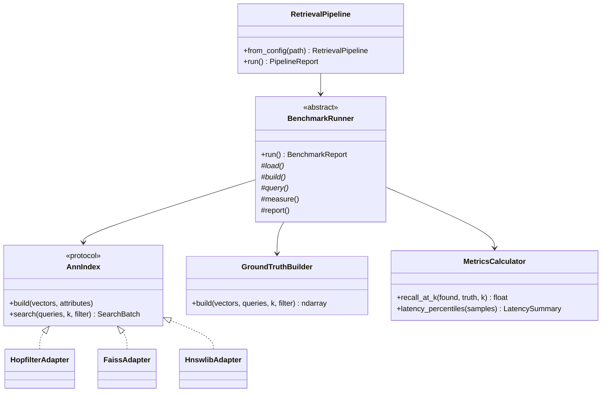

# Design

This document describes the architecture of hopfilter: its modules, their interfaces, who owns what, and the rules that keep the dependency graph acyclic. It is written **before** each module is implemented and updated in the same pull request whenever an interface changes.

!!! info "Status legend"
    Each section is tagged **Implemented** or **Planned (Phase N)**. Signatures in planned sections are the intended contract; small changes during implementation are expected and recorded in the [decision log](#12-decision-log).

---

## 1. Goals and non-goals

**Goals**

- A correct HNSW index written from the paper, readable enough to learn from.
- Filtered search that keeps recall high when the filter is strict, without falling back to a full scan unless that is actually cheaper.
- A two-tower training pipeline whose output feeds the index directly.
- Every component is replaceable behind a small interface, so baselines (FAISS, hnswlib) and our own strategies run through the same benchmark harness.

**Non-goals for v0.1**

- Quantization (IVF-PQ, scalar quantization), GPU, distributed sharding, online deletes.

---

## 2. System overview

**Implemented:** build skeleton only. **Planned:** everything else.



The end-to-end flow:

1. **Load and split** interactions by time, so no future interaction leaks into training.
2. **Train** the two towers with in-batch negatives and logQ correction.
3. **Export** item embeddings and item attributes; user embeddings are produced at query time.
4. **Build** the HNSW index over item embeddings and register item attributes.
5. **Search** with a user vector, `k`, and an optional filter expression.
6. **Evaluate** against exact brute-force ground truth computed with the same filter.

---

## 3. Layering and dependency rules

### 3.1 Layers

| Layer | May depend on | Must not depend on |
|---|---|---|
| `python/hopfilter/pipeline`, `cli` | every Python module | nothing above it |
| `python/hopfilter/{data,model,export,index,eval}` | `errors`, `_core`, third-party | `pipeline`, `cli`, each other except as listed in section 10 |
| `bindings/` | `hopfilter_core`, pybind11 | Python code |
| `core/` | the C++ standard library, OpenMP | Python, pybind11 |

### 3.2 C++ module graph

Arrows point from a module to what it depends on. The graph is acyclic, and each module becomes its own CMake target in Phase 2 so that every dependency is an explicit `target_link_libraries` line visible in review.

```mermaid
flowchart TD
    io --> index
    index --> search
    index --> graph
    search --> graph
    search --> filter
    search --> distance
    graph --> distance
    graph --> storage
    distance --> common
    storage --> common
    filter --> common
    graph --> common
```

| Module | Header directory | Phase |
|---|---|---|
| `common` | `hopfilter/common/` | 0 (version), 2 (types, errors, VisitedSet) |
| `distance` | `hopfilter/distance/` | 2 (scalar), 3 (SIMD) |
| `storage` | `hopfilter/storage/` | 2 |
| `graph` | `hopfilter/graph/` | 2 |
| `filter` | `hopfilter/filter/` | 4 |
| `search` | `hopfilter/search/` | 2 (unfiltered), 4 (filtered) |
| `index` | `hopfilter/index/` | 2 |
| `io` | `hopfilter/io/` | 2 |

---

## 4. Common vocabulary

**Implemented:** `hopfilter::version()`. **Planned (Phase 2):** the rest.

```cpp
namespace hopfilter {

using NodeId = std::uint32_t;
using LevelIndex = std::uint8_t;
using Dimension = std::size_t;

struct Neighbor {
    NodeId id;
    float distance;
};

using SearchResults = std::vector<Neighbor>;

class InvalidArgumentError : public std::invalid_argument { using std::invalid_argument::invalid_argument; };
class IndexStateError : public std::logic_error { using std::logic_error::logic_error; };
class SerializationError : public std::runtime_error { using std::runtime_error::runtime_error; };

}  // namespace hopfilter
```

- `NodeId` is 32-bit. An index holds at most 2^32 - 1 items, which halves the memory of neighbor lists compared to 64-bit ids.
- `SearchResults` is always sorted by ascending distance and never contains duplicate ids. Property tests enforce both.
- Vectors cross every interface as `std::span<const float>`, so callers never hand over ownership by accident.

---

## 5. C++ core modules

### 5.1 distance (Planned, Phase 2 scalar, Phase 3 SIMD)



- **Strategy.** Every metric returns a value where *smaller is closer*. Inner product returns `-dot(a, b)`, so search code never branches on the metric.
- **Cosine** expects normalized vectors. `CosineMetric` normalizes on insert and query and then reuses the inner-product kernel. That is cheaper than normalizing inside every distance call.
- **Runtime dispatch.** `DistanceKernels` holds function pointers resolved once from `CpuFeatures`. The AVX2/FMA kernels live in their own translation unit, which is the only one compiled with `-mavx2 -mfma` or `/arch:AVX2`. A wheel built this way runs on any x86-64 CPU and uses AVX2 only when the CPU has it.
- **Open/closed.** New metrics register with `MetricRegistry` under a config name, without touching existing classes.
- Virtual dispatch costs one indirect call per distance evaluation. Phase 3 measures it; if it shows up in profiles, the search loop is templated on the metric type, with the virtual interface kept for configuration.

### 5.2 storage (Planned, Phase 2)



- One contiguous allocation, 64-byte aligned. Each row is padded up to a multiple of the widest SIMD register, so kernels can use aligned loads with no tail handling.
- `capacity` is fixed at construction. Growing would invalidate spans handed out to concurrent readers, so `append` past capacity throws `IndexStateError`.

### 5.3 graph (Planned, Phase 2)



- **Level-0 layout.** Level 0 holds most edges and is read on every query, so its links live in one flat array of `(2 * M) + 1` slots per node: a count followed by up to `2 * M` ids. Upper levels hold few nodes and use per-node vectors.
- **LayerAssigner** draws `floor(-ln(U(0,1)) * mL)` with `mL = 1 / ln(M)`, as in the paper. A seed makes builds reproducible.
- **HeuristicNeighborSelector** follows Algorithm 4 of Malkov and Yashunin: a candidate is kept only if it is closer to the base than to every neighbor already selected. That keeps edges spread in different directions. `extendCandidates` and `keepPrunedConnections` are the paper's two optional flags.
- **VisitedSet** keeps one stamp per node and bumps an epoch counter on reset, so clearing it is O(1) rather than O(N). On counter wrap-around the stamps are cleared once.

### 5.4 index (Planned, Phase 2)



- **Builder.** `HnswIndexBuilder::build()` is the only way to create an `HnswIndex`. It validates the config (positive dimension, `maxNeighbors >= 2`, `efConstruction >= maxNeighbors`, a known metric name) and throws `InvalidArgumentError` with a message naming the field. Anything the caller does not inject gets a default, such as `HeuristicNeighborSelector` or the registry metric for `metricName`.
- **Dependency inversion.** `HnswIndex` never constructs its collaborators. It receives them from the builder, which is how tests inject a fake `LayerAssigner` to build a graph with known levels.
- **Interface segregation.** Benchmark adapters for FAISS and hnswlib implement only `Searchable`. Read-only consumers take a `const Searchable&`.

### 5.5 filter (Planned, Phase 4)



- Attributes are stored column-wise, which keeps a predicate check to one array read and makes columns cheap to scan when building a bitset.
- `AndPredicate`, `OrPredicate` and `NotPredicate` form a composite. Python filter expressions compile into this tree once per query.
- `ExactSelectivityEstimator` materializes a `BitsetPredicate` and counts its set bits; it is exact but O(N). `SamplingSelectivityEstimator` evaluates the predicate on a fixed-seed sample of ids, which is fast and good enough to choose a strategy.

### 5.6 search (Planned, Phase 2 unfiltered, Phase 4 filtered)



| Strategy | How it handles a filter | Strength | Weakness |
|---|---|---|---|
| `UnfilteredStrategy` | Ignores the filter (the request must have none) | Fastest path | n/a |
| `PostFilterStrategy` | Searches for `k * overFetchFactor` results, then drops non-matching ones | Free when most items match | Returns fewer than `k` results under strict filters |
| `PreFilterStrategy` | Brute force over matching ids only | Exact; cheap when very few items match | O(matching * d) per query |
| `InGraphStrategy` | Traverses the full graph and uses non-matching nodes as routing waypoints, but only matching nodes enter the result heap. Widens `ef` while the rejection rate is high | Keeps graph connectivity under medium selectivity | Visits more nodes than unfiltered search |
| `AdaptiveStrategy` | Estimates selectivity, then delegates | Picks the cheapest correct option | Estimation cost per query; thresholds need tuning |

`AdaptiveThresholds` holds two cut-offs, `postFilterAbove` and `exactBelow`, both set from the Phase 4 sweep and stored in config rather than in code.

`SearchContext` gives a strategy read-only access to the index internals plus a per-thread `VisitedSet`. Strategies therefore stay stateless, and one strategy instance serves all threads.

### 5.7 io (Planned, Phase 2)

`IndexSerializer` writes a versioned, little-endian binary format:

| Section | Contents |
|---|---|
| Header | Magic `HOPF`, format version (uint32), endianness marker, `IndexConfig` fields |
| Vectors | Row count and stride, then raw aligned rows |
| Graph | Node levels, entry point, max level, level-0 link block, upper-level links |
| Attributes | Optional: column names, types and values (Phase 4) |
| Footer | CRC-32 of every preceding byte |

- Loading checks magic, version and CRC before allocating anything large, and throws `SerializationError` on any mismatch.
- **Compatibility rule:** version N reads files from versions N and N-1. A fixture index saved by the previous release is checked into `tests/fixtures/` and loaded in CI.

---

## 6. Key algorithms

All follow Malkov and Yashunin (arXiv:1603.09320). Only the shape is described here; the implementation is written from the paper.

**Insert(q)**

1. Draw level `l` from `LayerAssigner`.
2. From the entry point, greedily descend through levels `maxLevel ... l+1` with `ef = 1`.
3. For each level `min(l, maxLevel) ... 0`: run `searchLayer(q, entry, efConstruction)`, choose neighbors with `NeighborSelector` (`M` on upper levels, `2M` on level 0), connect both directions, and shrink any neighbor list that overflows by re-running the selector on it.
4. If `l > maxLevel`, `q` becomes the new entry point.

**searchLayer(q, entries, ef)** is a best-first search with a min-heap of candidates and a bounded max-heap of results. It stops when the closest unexplored candidate is farther than the farthest kept result.

**Filtered searchLayer** (`InGraphStrategy`) adds two rules. A node always enters the candidate heap, so it can still be used to route. A node enters the result heap only if `filter.matches(id)`. After every `rejectionWindow` expansions, if the share of rejected nodes is above a threshold, `ef` grows by `efGrowthFactor` up to `maxEf`.

---

## 7. Concurrency contract

| Operation | Guarantee |
|---|---|
| `search` on a built index | Lock-free and safe from any number of threads. Each thread uses its own `VisitedSet` from a thread-local pool |
| `insert` | Serialized by `insertMutex_` in v0.1. Phase 3 moves to per-node locks for parallel build |
| `search` concurrent with `insert` | Not supported in v0.1. Documented, and asserted in debug builds |
| `save` | Safe concurrently with `search`; not with `insert` |
| Python | The GIL is released inside `search` and batch `insert`, so Python threads scale |

The TSan CI job runs a concurrent-search stress test, and from Phase 3 a parallel-build test.

---

## 8. Ownership and memory

- `HnswIndex` owns everything it uses through `std::unique_ptr` members. There are no shared pointers and no raw owning pointers.
- Strategies, selectors and predicates hold `const&` to data they do not own. Their lifetime is bounded by the call or by the owning index.
- Memory per item is roughly `4 * stride + 4 * (2M + 1) + small upper-level overhead`. Phase 3 reports measured peak memory next to this estimate.

---

## 9. Error handling

| Where | Mechanism |
|---|---|
| C++ API boundary (builder, insert, search arguments, load) | Throw `InvalidArgumentError`, `IndexStateError` or `SerializationError` with a message naming the bad field |
| C++ hot loops (distance, searchLayer) | No exceptions and no allocation; inputs are validated before the loop |
| Bindings | Each C++ error type is registered with pybind11 and surfaces as the matching Python error below |
| Python | `InvalidConfigError(HopfilterError, ValueError)`, `IndexNotBuiltError(HopfilterError, RuntimeError)`, plus more added only when a caller needs to tell them apart |

The Python error types are **implemented** in `hopfilter.errors`.

---

## 10. Python package

### 10.1 Model and training (Planned, Phase 1)



- **logQ correction** (Yi et al., RecSys 2019). With in-batch negatives, popular items appear as negatives far more often than uniform sampling would produce. Subtracting `log Q(item)` from each logit before the softmax corrects for that sampling distribution. `ItemFrequencyEstimator` maintains `Q` with the streaming estimate from the paper, so it never needs a full pass over the data.
- Both towers L2-normalize their output, so inner product equals cosine similarity and the index uses `InnerProductMetric`.

### 10.2 Index, evaluation and pipeline (Planned, Phases 2 and 5)



- **Adapter.** Every library is driven through `AnnIndex`, so timing code is shared and the comparison is fair by construction.
- **Template Method.** `BenchmarkRunner.run()` fixes the order (load, build, warm-up, query repeats, measure, report). Subclasses override only the dataset-specific steps.
- **Facade.** `RetrievalPipeline` is the only class the CLI talks to.
- Configs are frozen dataclasses parsed from YAML. An unknown key raises `InvalidConfigError` instead of being silently ignored.

---

## 11. Extension points

| To add | Implement | Register with | Touch existing classes? |
|---|---|---|---|
| A distance metric | `DistanceMetric` | `MetricRegistry` | No |
| A neighbor selection rule | `NeighborSelector` | `HnswIndexBuilder::withNeighborSelector` | No |
| A filtered search strategy | `SearchStrategy` | Strategy registry / `AdaptiveStrategy` delegates | No |
| A predicate type | `FilterPredicate` | Filter expression compiler | Compiler only |
| A dataset | `DatasetLoader` | Dataset registry | No |
| A loss | `LossFunction` | Loss registry | No |
| A baseline library | `AnnIndex` adapter | Benchmark config | No |

---

## 12. Decision log

| # | Date | Decision | Why |
|---|---|---|---|
| 1 | 2026-10-17 | C++20 instead of C++17 | `std::span` for non-owning vector views, concepts for kernel templates, `std::bit_width`/`popcount` for bitsets. Supported by every compiler in the CI matrix |
| 2 | 2026-10-17 | Python 3.13 minimum, 3.14 for development | Current interpreters only; fewer wheels to build and test |
| 3 | 2026-10-17 | uv with dependency groups and `uv.lock` | One command (`uv sync`) builds the extension and installs pinned tooling, and pre-commit and CI reuse the same lock |
| 4 | 2026-10-17 | pybind11 3 over nanobind | Mature NumPy buffer support and exception translation; revisit if binding overhead shows up in Phase 3 profiles |
| 5 | 2026-10-17 | Package version read from `CMakeLists.txt` | One source of truth for the C++ library and the Python distribution |
| 6 | 2026-10-17 | 32-bit `NodeId` | Halves neighbor-list memory; v0.1 targets at most tens of millions of items |
| 7 | 2026-10-17 | Smaller-is-closer for every metric | Search code never branches on metric type |
